# Attribution and original source

This repository contains the original Soren project by **snipedbywifi**.

- **Original author:** [snipedbywifi](https://gitlab.com/snipedbywifi)
- **Original GitLab repository:** [https://gitlab.com/snipedbywifi/soren](https://gitlab.com/snipedbywifi/soren)
- **Copyright:** 2026 snipedbywifi
- **License:** Apache License 2.0 (see [LICENSE](LICENSE) and [NOTICE](NOTICE))

This GitHub repository is a copy prepared for submission/hosting by [realwarp](https://github.com/realwarp). The original project and its underlying work remain credited to snipedbywifi. No claim of original authorship is made by the GitHub host.

---

# Soren

**Software Reasoning Navigator.** For people that run multiple coding agents, while keeping an eye on their usage limits all the time.

**Beta** · v1.0.x

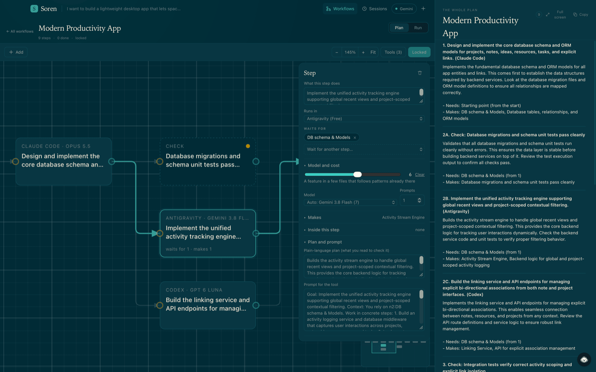

| [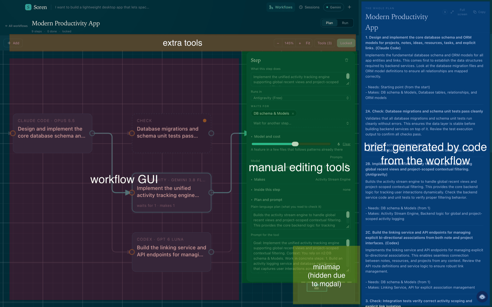{width=100%}](docs/img/02-studio-annotated.png) | [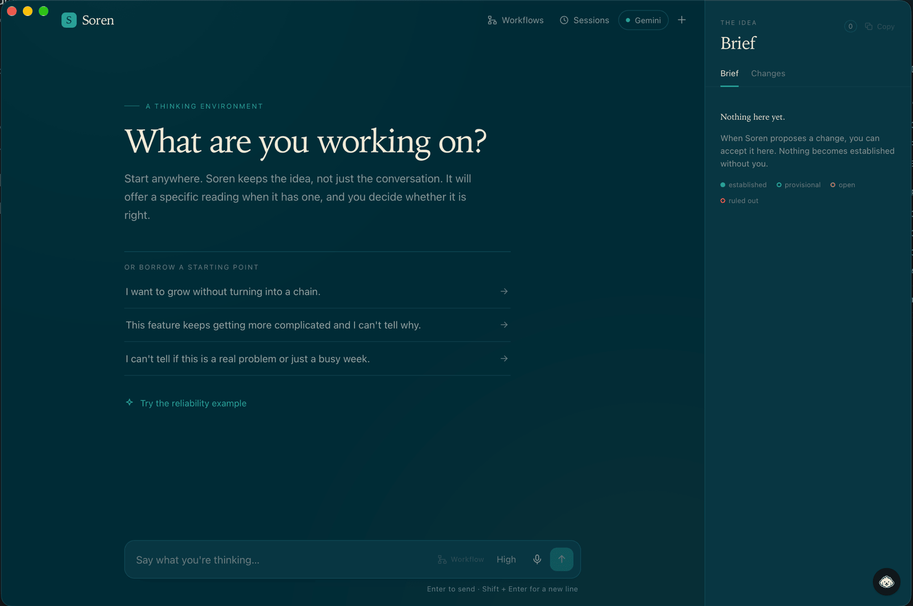{width=100%}](docs/img/03-start-screen.png) |
| --- | --- |
| *The same screen, labelled. Click to enlarge.* | *The start screen. Click to enlarge.* |

## What Soren doesn't do

Soren plans. It doesn't launch your agents, and it never starts a workflow by itself.

- It won't run Claude Code, Codex or anything else for you. In the Run tab it tells you what to give each agent and passes along what comes back.
- It won't draw a workflow until you ask. Everything else you build by hand on the canvas.
- It doesn't write your code. The agents you already have do that.

**If you want an app that runs your agents for you, this isn't the one.**

## Install

Grab the latest build from [Releases](https://gitlab.com/snipedbywifi/soren/-/releases): a `.dmg` for Apple Silicon Macs, a `-setup.exe` for 64-bit Windows.

The builds aren't signed yet. On macOS, right-click the app and choose Open. On Windows, choose More info, then Run anyway.

First launch is Demo mode, which needs no key. For a real model, add a Gemini key, any OpenAI-compatible endpoint, or a local llama.cpp server under Settings.

## Build from source

```bash
npm install
npm run tauri dev
```

You need Node 20 or newer, stable Rust, and [Tauri's platform prerequisites](https://v2.tauri.app/start/prerequisites/). Tests run with `npm test`.

## A brief summary, with details below

The walkthrough below, as a list:

1. **Build it.** Add steps by hand, or double-click the canvas and describe the idea to have one drawn. Soren only draws a workflow when you ask.
2. **Check the graph.** Each node has a tool, a model, what it needs and what it makes. Edit any of it by hand.
3. **Get the prompts.** Each step's prompt is filled in by code from its fields, with no model call. Polish a step, or the whole workflow, when you want the model to reword it, and accept or reject each rewrite.
4. **Read the plan.** Built from the graph by code, with parallel steps lettered (2A, 2B, 2C).
5. **Run it.** The Run tab walks you through each step, carries each agent's output to the next one, and ends on an approval for you.

The plan knows about your limits: it orders work by when each tool's quota resets, and waits when one runs dry.

Read the entire workflow below!

## A detailed example

You've worked with agents before, you know the hassle of planning. You know the hassle of making ten agents from different plans, subscriptions, and free tiers work together, not knowing what you should give each agent.

Soren fixes this. You collaborate with it, lay out your ideas, your thoughts, and receive a "workflow". What's a workflow, you ask?

It's the plan Soren builds from your half-formed ideas.

Here's an example. I (yes, me, snipedbywifi) asked Soren to make a modern productivity app (this isn't an actual idea I'm pursuing, it's simply a boilerplate test/benchmark). This is how it went, judge for yourself :/

| 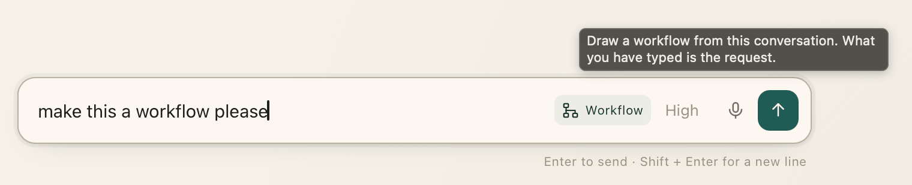{width=100%} |
| :---: |
| *Pressing the button explicitly is the only way to trigger a workflow, other methods have been tested, though this seemed like the best option. **Soren cannot automatically generate workflows without manually pressing the "workflow" button.*** |

| 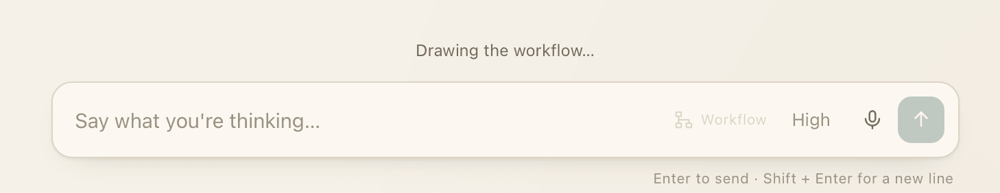{width=100%} |
| :---: |
| *Soren first generates nodes for the workflow, in an efficient manner, using Gemini 3.5 Flash Lite (customizable to any model by any provider that uses an OpenAI-compatible endpoint)* |

| 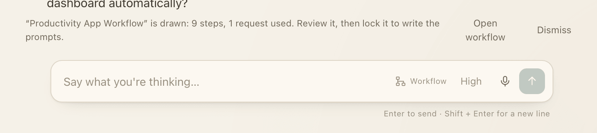{width=100%} |
| :---: |
| *Showcasing the efficiency of Soren, wasting no requests and optimizing for the Gemini free-tier* |

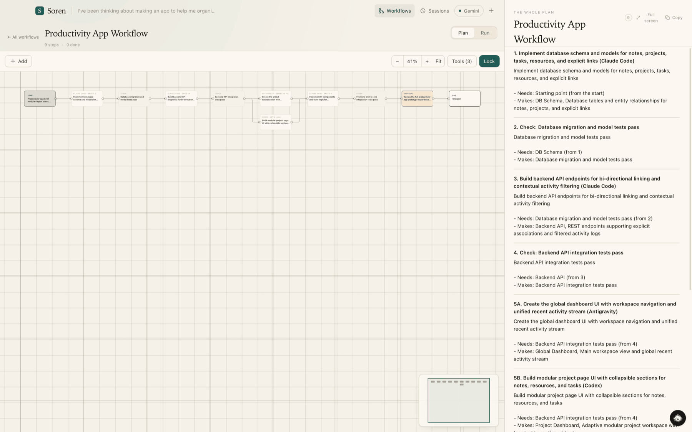

*What it made, with no changes or alterations. A zoomed in version is available in the next screenshot.*

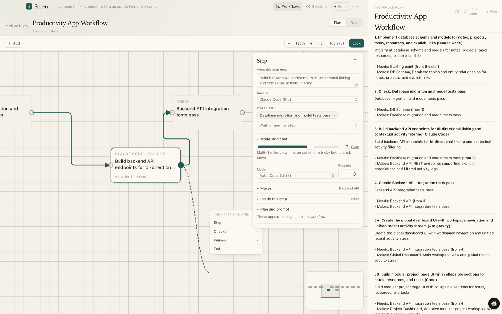

*Example of the node graph in action, the dotted line cuts off weird as it follows the cursor pointer, it's only an artifact particular to this screenshot.*

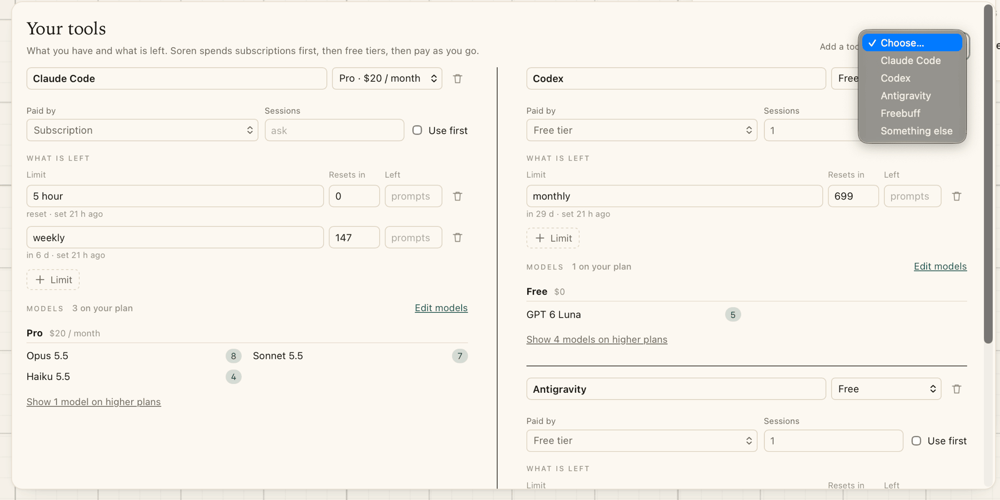

*Configuring your tools is easy, and Soren's prompt agent adapts to the tools you provide, to minimize costs while keeping performance at the level that you want it at.*

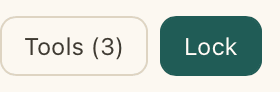

*Confirming you want to continue with this node graph, and generate all the agent prompts is one press away.*

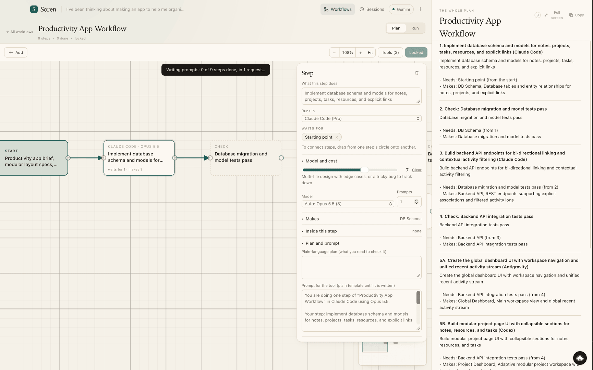

*A showcase of efficiency, again. Prompts are batched and written, to save model calls, and get free-tier APIs to be used as they should be. This simple app required only 1 agent call.*

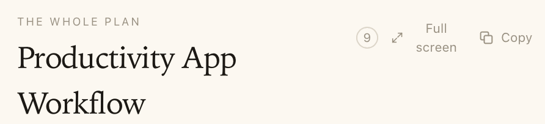{width=100%}

*Reviewing the plan is simple, again, as you can simply full screen it*

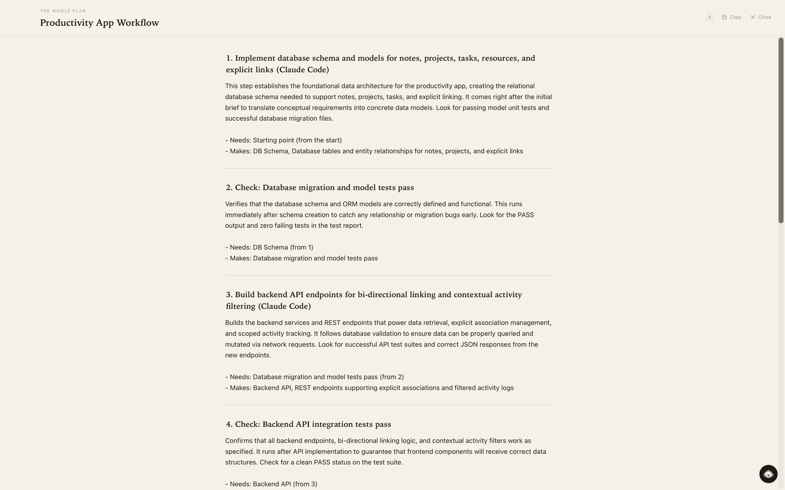

*The plan is simple to review, and it costs no agent calls as it is built from the node graph itself. It is also aware of parallel vs sequential segments, dividing points into "A", "B" and so on, in case of parallel execution.*

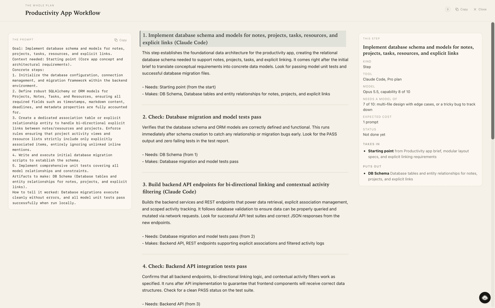

*When reviewing each section, you can delve into the specifics. Switching across sections is simply `left_arrow`/`right_arrow`*

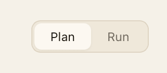

*Once you review the plan, you can switch the agent over to the "run" tab*

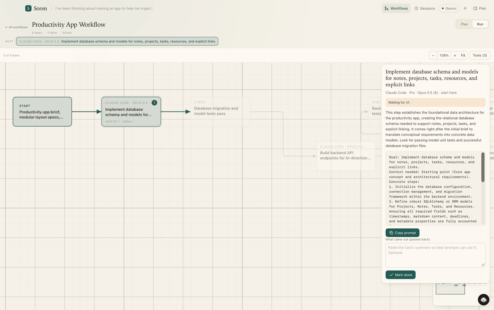

*Soren gives you step-by-step instructions on executing your plan, and can deterministically adapt the workflow with no agent calls, by receiving agent output and passing it to the immediate next agent, allowing it to not form baseless assumptions. SIDENOTE: the plan tab disappeared as I manually closed it, which can be done by compressing it to `<300px`.*

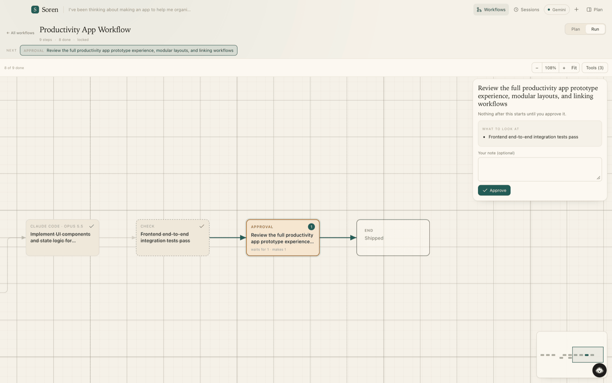

*Soren defaults to ending on an approval, allowing you to decide if anything is right or wrong. In future designs, an agent would review this. For now, it is simply a way to note down your experience to later change your work with Soren.*

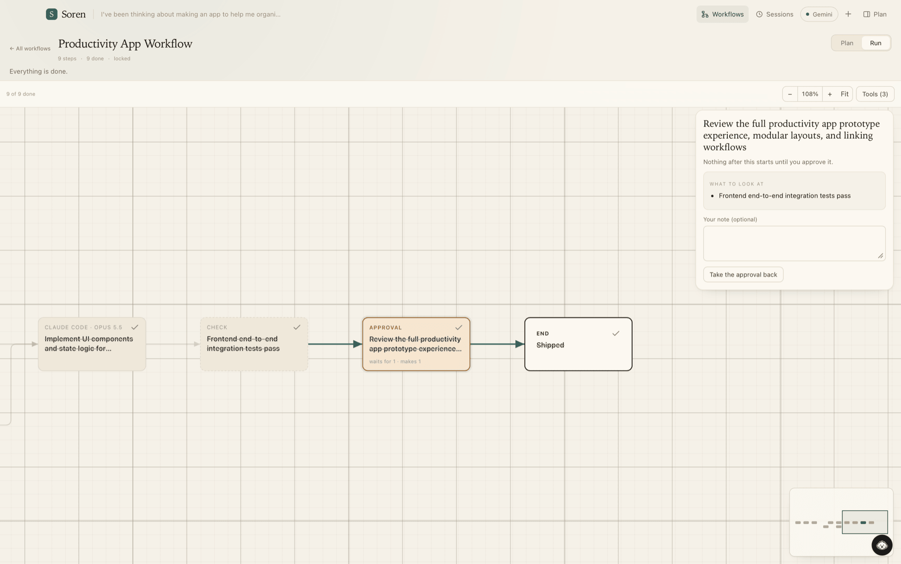

*The workflow is complete!*

## Prompts, history and plan

Every step has a prompt that code fills in from the step's fields: what it does, what it needs from earlier steps, what it makes, its checks, the tool and model, and the decisions you settled. It is there at once and changes as the fields change. The cloud model only polishes a prompt when you press Polish, and its rewrite is shown as a word-by-word diff that you accept or reject. A faint mark in the margin shows who wrote each part: the template, the model, or you.

Each workflow keeps a History of what you asked, what you answered, what the agent said, and whether its change was applied or rejected.

The plan on the right is the whole workflow as one document, built by code from the graph. Reading it costs no model calls.

## License

Apache 2.0.

---

The longer reference from before 1.0 is in [docs/REFERENCE.md](docs/REFERENCE.md), until there is a wiki.
